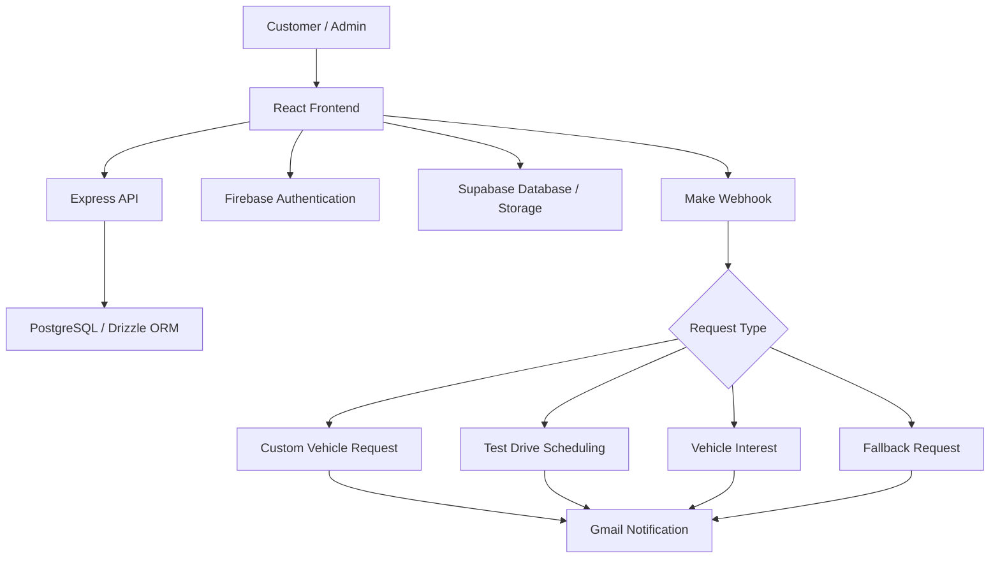

# 🏎️ Torque & Throttle — Certified Performance Marketplace

A full-stack web application for discovering performance vehicles, viewing specifications, submitting enquiries, and managing vehicle inventory.

## 🚀 Features
- Browse and filter vehicle listings
- View vehicle specifications and images
- Submit custom vehicle requests and test-drive bookings
- Express interest in available vehicles
- Admin dashboard for inventory management
- Firebase authentication
- AI agent workflow for automated email notifications

## 🛠️ Tech Stack
- **Languages:** TypeScript, JavaScript, HTML, CSS
- **Frontend:** React, Vite, Tailwind CSS
- **Backend:** Node.js, Express.js
- **Database:** PostgreSQL, Supabase
- **Authentication:** Firebase
- **ORM:** Drizzle ORM
- **Automation:** Make Webhooks, Gmail

## 🏗️ Architecture



## 🤖 AI Agent & Automation

The website integrates with a **Make automation scenario** through a webhook. It evaluates the incoming request type and sends a formatted email through Gmail.

- **Custom Vehicle Request:** Sends the requested vehicle/model, acquisition timeline, customer name, and contact details.
- **Test Drive Scheduling:** Sends the target vehicle, preferred date, customer name, mobile number, and special instructions.
- **Interested:** Sends the inventory unit and customer contact details. Supports variations such as "interested" and "I'm Interested."
- **Fallback:** Sends an email containing the unmatched request type and received data.

All four branches send emails to the same configured recipient.

**Status:** The scenario is configured, but its live execution has not been verified. Successful processing of real requests is therefore not confirmed.

## ⚙️ Installation

```bash
git clone https://github.com/VIndrajith/TnT.git
cd <YOUR_PROJECT_FOLDER>
npm install
cp .env.example .env
```

Configure the required environment variables in `.env`.

## ▶️ Run the Project

```bash
npm run dev
```

## 🏗️ Build & Check

```bash
npm run lint
npm run build
```

## 🔄 Workflow
1. Customers browse vehicles and view details.
2. They submit enquiries, test-drive bookings, or custom requests.
3. The configured Make webhook routes requests to the appropriate email branch.
4. Gmail sends a formatted notification to the configured recipient.
5. Admins manage vehicle listings through the dashboard.

## 🔐 Security
- Keep credentials and private API keys out of GitHub.
- Enforce administrator permissions on protected API endpoints.
- Configure database access policies and webhook security.

---

**Torque & Throttle** — Performance meets precision.


## Run Locally

**Prerequisites:**  Node.js


1. Install dependencies:
   `npm install`
2. Set the `GEMINI_API_KEY` in [.env.local](.env.local) to your Gemini API key
3. Run the app:
   `npm run dev`
